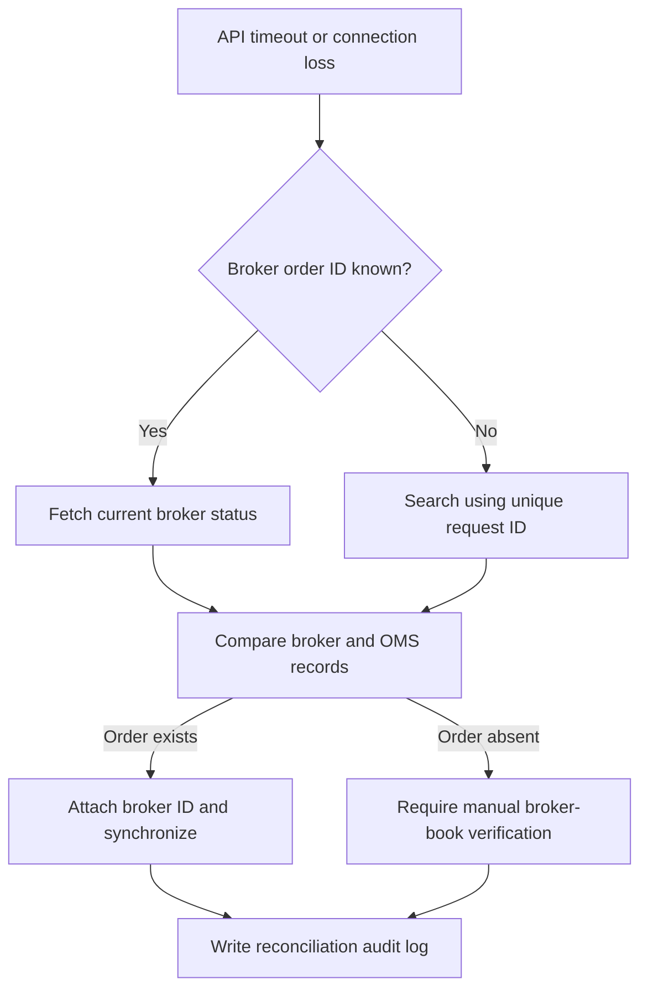

An absent search result is not treated as proof that submission failed. Broker
history may be incomplete or session-scoped, so an uncertain `SUBMITTED` child
is never automatically placed again.

Basket child recovery is state-specific:

- `PENDING` with a failed execution job can be requeued safely because broker
  submission was never claimed.
- `SUBMITTED` without a broker order ID must be recovered by the original child
  order ID before synchronization; it is never sent again blindly.
- `REJECTED` is terminal. A new single-client basket for only the unfilled
  quantity, with a new order identity, is created and linked to the rejected
  source. A deterministic replacement basket ID uses the existing primary key
  to permit only one replacement basket per rejected child.

## Execution-job ownership and recovery

Execution jobs are durable PostgreSQL rows. Claiming uses `FOR UPDATE SKIP
LOCKED`, changes the job to `PROCESSING`, increments its attempt count, and
assigns a random lease token. The worker refreshes `lockedAt` while execution is
active. Completion, retry, and failure updates require the same lease token, so
a delayed worker cannot overwrite a job recovered by another worker.

Lease recovery runs independently from normal queue draining. An expired lease
returns to `PENDING` while attempts remain and becomes `FAILED` at the attempt
limit. Retryable failures use exponential delay with bounded jitter; definitive
validation and broker rejections terminate immediately. Completed jobs are kept
for 30 days and failed jobs for 90 days by default, then removed by maintenance.

The worker drains a bounded batch while jobs are available and applies adaptive
idle polling when the queue is empty. This avoids a permanently hot polling
loop while preserving short latency when new work arrives. Current queue state,
oldest pending age, stale leases, worker heartbeat, maintenance errors, and
recent failures are exposed only to authorized administrators and Operations
users through `GET /api/operations`.
